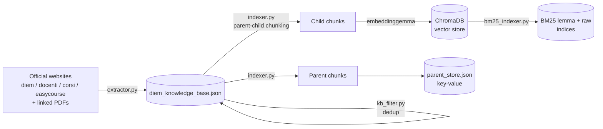
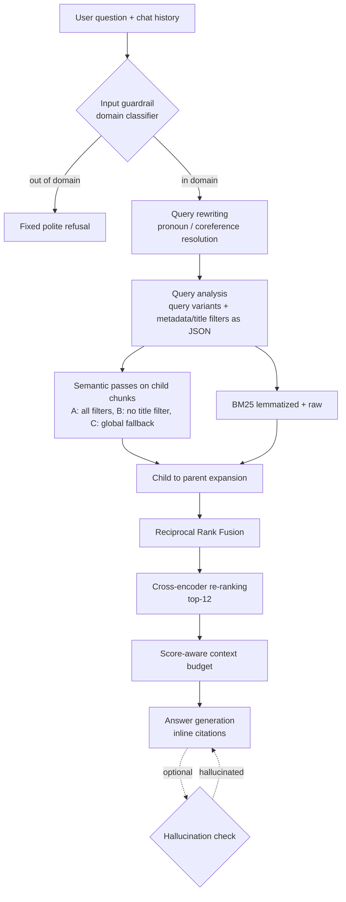

# DIEM Assistant — Hybrid Agentic RAG for a University Department

A conversational assistant that answers students' questions about the **DIEM** department (Department of Information and Electrical Engineering and Applied Mathematics, University of Salerno) using **only** official university sources, always citing them as inline links.

It is an end-to-end **Retrieval-Augmented Generation** system: a custom web crawler builds the knowledge base, a parent-child indexer turns it into a vector + lexical index, and a **LangGraph** agent combines guardrails, query rewriting, hybrid retrieval, cross-encoder re-ranking and a score-aware context budget before generating the answer. It ships with a **Chainlit** web UI and a **RAGAS** evaluation pipeline.

> Project work for the *Natural Language Processing and Large Language Models* course, MSc in Computer Engineering (AI), University of Salerno. The assistant answers in Italian, the language of its sources.

---

## Highlights

- **Domain-specific crawler**: 4 university portals and the PDFs they link to, with per-source metadata (professor, academic year, call category, timetable type) reused later as retrieval filters.
- **Knowledge-base deduplication**: URL normalization, content hashing, *year-versioned* PDF dedup (keep only the latest regulation) and cross-domain dedup.
- **Parent-child chunking**: small, metadata-enriched *child* chunks are embedded for precise search; larger *parent* chunks are returned to the LLM for context. Deterministic SHA-256 ids, incremental re-indexing and a post-indexing sanity check.
- **Hybrid retrieval**: multi-pass semantic search with LLM-extracted metadata filters and automatic fallbacks, plus **dual BM25** (lemmatized with spaCy and raw, to keep acronyms like `CUN` or `ISPD`), merged with **Reciprocal Rank Fusion**.
- **Re-ranking and context budgeting**: `BAAI/bge-reranker-v2-m3` cross-encoder, then a softmax-weighted allocation of the character budget that gives more room to the most relevant documents.
- **Agentic control flow (LangGraph)**: input guardrail (domain classifier), history-aware query rewriting (coreference resolution), optional hallucination checker with bounded regeneration. Every node can be switched on or off from `config.py`.
- **Grounded answers**: strict system prompt (context-only answers, verbatim proper nouns, inline source links, no invented numbers) and an anti-babbling guard.
- **Evaluation**: 62-question benchmark scored with RAGAS (faithfulness, answer relevancy, context precision/recall, answer correctness).

## Architecture

### Offline: knowledge base and indexing



### Online: the LangGraph agent



An in-domain question costs **4 LLM calls** (classification, rewriting, query analysis, generation); an out-of-domain one costs a single call. Retrieval, BM25 and re-ranking run locally.

## Results

RAGAS evaluation on **61 questions** (62-question benchmark, one excluded because it was correctly classified as out of domain), with manually corrected reference answers:

| Metric | Score |
|---|---|
| Faithfulness | 0.762 |
| Answer Relevancy | 0.748 |
| Context Precision | 0.760 |
| Context Recall | **0.845** |
| Answer Correctness | **0.801** |

The high context recall shows that retrieval almost always finds the information needed; the main room for improvement is in ranking precision. The lower faithfulness scores mostly come from plausible details assembled from several retrieved passages rather than from invented facts. The references were obtained by correcting the system's own answers, so Answer Correctness is not a fully independent accuracy measure.

## Tech stack

| Area | Tools |
|---|---|
| Orchestration | LangGraph, LangChain |
| LLMs | `openai/gpt-oss-120b` via OpenRouter (or any local model via Ollama) |
| Embeddings | `embeddinggemma` (Ollama) or any HuggingFace sentence-transformers model |
| Vector store | ChromaDB |
| Lexical search | rank-bm25, spaCy `it_core_news_lg` |
| Re-ranking | `BAAI/bge-reranker-v2-m3` (sentence-transformers CrossEncoder) |
| Crawling | requests, BeautifulSoup, trafilatura, pymupdf4llm, ftfy |
| UI | Chainlit |
| Evaluation | RAGAS |

## Repository structure

| File | Role |
|---|---|
| `extractor.py` | Crawler: builds `diem_knowledge_base.json` from the university websites and PDFs |
| `kb_filter.py` | Knowledge-base deduplication (HTML: URL + content hash; PDF: year versioning, content hash, cross-domain) |
| `indexer.py` | Parent-child chunking, embedding into ChromaDB, parent store, incremental indexing, sanity check |
| `bm25_indexer.py` | Builds the lemmatized and raw BM25 indices from the child chunks |
| `chatbot.py` | LangGraph agent (guardrail, rewriting, hybrid retrieval, re-ranking, generation) plus a terminal chat |
| `DIEM_assistant.py` | Chainlit web interface |
| `batch_test.py` | Runs question sets as one conversation and logs answers and retrieval traces |
| `RAGAS.py` | RAGAS evaluation from saved test logs and manually corrected references |
| `config.py` | Paths, hyper-parameters, feature flags and model factories |
| `public/`, `.chainlit/` | UI theme, logos, custom CSS/JS and Chainlit configuration |

## Getting started

### 1. Install

```bash
python -m venv .venv
source .venv/bin/activate        # Windows: .venv\Scripts\activate
pip install -r requirements.txt
python -m spacy download it_core_news_lg
```

You also need [Ollama](https://ollama.com) running locally for the default embedding model:

```bash
ollama pull embeddinggemma
```

### 2. Configure

```bash
cp .env.example .env             # then set OPENROUTER_API_KEY
```

To run fully locally, set `USE_OPENROUTER = False` in `config.py` (it uses `llama3.1` through Ollama).

### 3. Build the knowledge base and the indices

```bash
python extractor.py      # crawl (takes a while; writes diem_knowledge_base.json)
python kb_filter.py      # deduplicate
python indexer.py        # chunk + embed into ChromaDB
python bm25_indexer.py   # build the BM25 indices
```

### 4. Chat

```bash
chainlit run DIEM_assistant.py   # web UI on http://localhost:8000 (or: python DIEM_assistant.py)
python chatbot.py                # or a terminal chat with full debug traces
```

### 5. Evaluate

```bash
python batch_test.py --set 2     # 62-question benchmark -> test_results/batch_test_<timestamp>.md
python RAGAS.py --test-log <generated log> --ground-truth <manually corrected copy>
```

## Configuration

Every stage can be tuned or toggled from `config.py`, which made it possible to run ablations during development:

| Flag | Default | Effect |
|---|---|---|
| `ENABLE_DOMAIN_CHECK` | `True` | Input guardrail (domain classifier) |
| `ENABLE_QUERY_REWRITING` | `True` | History-aware query rewriting |
| `ENABLE_TITLE_FILTER` | `True` | Lets the query analyzer restrict search to a canonical document title |
| `ENABLE_CONTEXT_BUDGET_ALLOCATION` | `True` | Score-aware context truncation instead of a plain cut |
| `ENABLE_HALLUCINATION_CHECK` | `False` | Output guardrail with bounded regeneration |
| `APPLY_RETRIEVAL_THRESHOLD` | `False` | Relative threshold on reranker scores |
| `INCREMENTAL_INDEXING` | `True` | Re-embed only new/changed documents and purge removed ones |

Main retrieval hyper-parameters: `K_CHILDREN=125`, `K_CHILDREN_BM25=60`, `TOP_K=12`, `MAX_CONTEXT_CHARS=16000`, `RRF_K=60`.

## Design decisions

- **Parents outside the vector store.** Parents are never searched by similarity, only looked up by id, so they are kept in a JSON key-value store loaded in memory (O(1) lookups) instead of being embedded. This keeps the vector index smaller and avoids useless embedding work.
- **Metadata in the chunk text.** Each child starts with a `Document: <title>` / `Metadati: [...]` header, which gives the embedding model and BM25 explicit signals (professor, year, call type) and makes the title filter (`$contains`) reliable.
- **Filters with fallbacks.** LLM-extracted filters can be wrong, so retrieval repeats the search without the title filter (pass B) and falls back to an unfiltered search when the filtered pool is too small (pass C).
- **Two BM25 indices.** Lemmatization improves recall on inflected Italian words but destroys acronyms and codes; a raw-token index keeps them.
- **Hallucination checker off by default.** In testing, the strict prompt and the metadata headers made factual hallucinations rare (most were long degenerate outputs, caught by the anti-babbling guard), and a fifth LLM call was not worth the extra latency and API quota.

## Limitations and future work

- Latency depends on a hosted LLM API (OpenRouter); local models that fit the available hardware were noticeably weaker on this task.
- The knowledge base is a snapshot: re-run the crawler and the incremental indexer to refresh it.
- Possible next steps: self-reflective loops (document grading, iterative retrieval) on dedicated inference hardware, tool use against university APIs (e.g. exam booking), vision-language models for charts and floor plans, and scaling to the whole university with a distributed vector database.

## Team

Developed by Group 03 for the NLP & LLM course at the University of Salerno:
Salvatore Francesco Tartaglione, Raffaele Calabrese, Christian Rosa, Candido Simone Savino.
